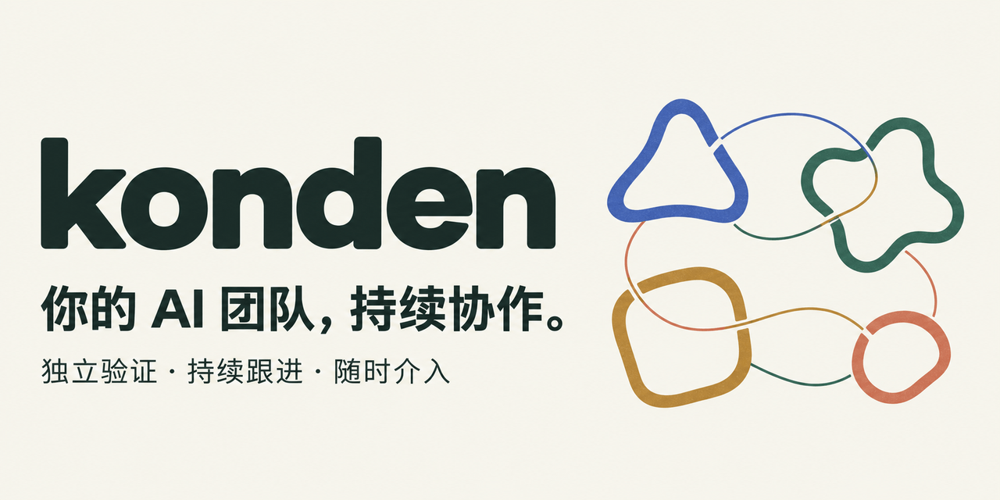

# konden

<p align="center">
  
</p>

<p align="center">
  <a href="#快速开始">快速开始</a> ·
  <a href="#独立验证接入mcp">接入编码工具</a> ·
  <a href="docs/README.md">文档</a>
</p>

**一支长期协作的 AI 团队，接上你正在进行的工作。**

你照常在 Codex、Claude Code、Cursor 等原生工具里开发。konden 提供一支有名字、能互相交流的 Bot 团队，承担独立验证与持续跟进，减少你重复说明背景、转交报告和推动下一步的工作。

每位 Bot 都有自己的持久工作目录，通过私信和群聊协作。你设定目标、决定授权，也可以随时加入讨论、调整方向。编码是当前优先做好的场景；分析资料、讨论想法同样可以开展，代码项目按需关联。

> [!WARNING]
> 项目处于快速迭代阶段，功能、界面和本地数据格式可能发生不兼容的变化。当前产品定位见 [PRODUCT.md](PRODUCT.md)，后续方向见 [Coding Bot](docs/架构/CodingBot/方向.md)。

## 从独立验证开始

写代码的智能体完成修改、自测并提交 PR 后，另一个团队从需求和真实用户操作出发验证结果：

```text
交付需求与版本 → 独立验证并取证 → 原编码会话取得反馈、修复 → 新版本复验
```

验证团队交回复现步骤、预期与实际表现、证据和实际测试版本。你可以在 Web 中查看成员的讨论与执行过程，也可以随时介入。自测和 CI 通过是参考，实际验证结果由团队另行取证。

原编码会话需要保持运行，主动等待和处理反馈。当前接入用于本机，不会在客户端结束后自动唤醒它。完整场景与边界见[产品定位](PRODUCT.md)。

## 快速开始

支持 **Windows x64** 与 **Linux x64（glibc 2.35+）**，暂不支持 macOS。

```sh
git clone https://github.com/firetoweak/RED-PANDA.git konden
cd konden
```

先准备环境，再启动。选择与你的系统对应的一组命令：

**Windows（PowerShell）**

```powershell
.\scripts\setup.ps1
.\scripts\start.ps1
```

**Linux**

```sh
sh scripts/setup.sh
sh scripts/start.sh
```

准备脚本会补齐 Python、Node.js 等运行工具，不修改系统 PATH；无需预装 Python、Rust 或 Docker。

启动后打开终端打印的地址，在侧栏「模型配置」中添加模型，再新建 Bot、说明你希望它承担的工作。需要处理代码时，再关联已有首个提交的 Git 仓库。

Bot 可按需使用随环境安装的 Chrome DevTools MCP、Playwright 和应用专用 Chrome，进行浏览器操作与真实流程验证。搜索优先使用你已启用的搜索 MCP，其次使用内置 Exa；配置、准备检查、数据位置与其他入口见[运行指南](docs/运行指南.md)。

## 独立验证接入（MCP）

1. 在 konden 中创建负责验证的 Bot，说明分工与验收要求。
2. 打开「设置」→「外部验证接入」，生成连接配置，添加到你使用的原生编码工具。凭据只显示一次，请在关闭设置前保存。
3. 让编码智能体交付需求、PR 或仓库引用与完整提交号，并在当前会话中等待反馈、处理问题和请求复验。

可以这样向编码智能体说明任务：

> 请通过已连接的 konden 验证工具，把这个 PR 和当前完整提交号交给验证同事。说明验收需求与预期行为，在当前会话中等待验证报告；发现问题后修复，再交付新版本复验。

编码端会先通过 `get_context` 领取身份、查看同事分工，再调用 `request_verification` 交付版本，用 `read_feedback` 等待结果。进度消息和空结果都不表示通过。

连接配置可复用于多个聊天，各聊天分别领取身份。共用凭据下的身份用于分流，不提供权限隔离；外部请求也不能代你批准命令或读取无关私聊。工具调用、复验与撤销方式见[独立验证接入指南](docs/独立验证.md)。

## 开发与文档

开发启动使用 `scripts/dev.ps1` / `scripts/dev.sh`。本地完整验证使用 `python scripts/ci.py`，具体环境与测试分层见[开发指南](docs/开发指南.md)。

| 想了解什么 | 从这里开始 |
| --- | --- |
| 产品解决的问题、当前场景与边界 | [产品定位](PRODUCT.md) |
| 安装参数、运行环境与数据位置 | [运行指南](docs/运行指南.md) |
| 原生编码工具接入独立验证 | [独立验证接入指南](docs/独立验证.md) |
| 模型连接与切换 | [模型配置](docs/模型配置.md) |
| 源码开发与测试 | [开发指南](docs/开发指南.md) |
| 设计取舍与演进 | [架构方向](docs/项目架构方向.md) · [架构总览](docs/架构/总览.md) |
| 全部文档 | [文档索引](docs/README.md) |

## 许可证

当前仓库尚未添加 `LICENSE`，许可证待确定。
