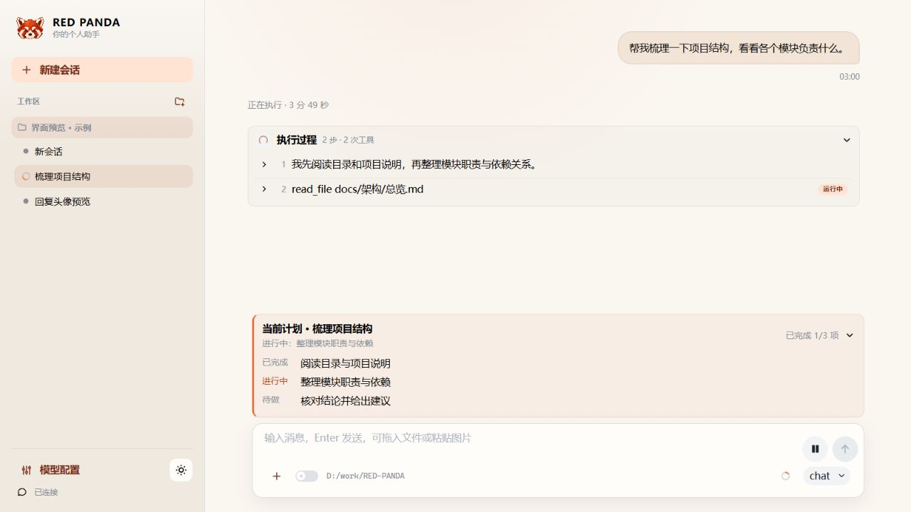

<p align="center">
  
</p>

<h1 align="center">RED PANDA</h1>

<p align="center">面向开发者的 coding agent。</p>

<p align="center">
  <a href="#功能">功能</a> ·
  <a href="#快速开始">快速开始</a> ·
  <a href="#开发与测试">开发与测试</a> ·
  <a href="#文档">文档</a>
</p>

连接你选择的模型，让助手在代码工作区里理解项目、修改文件、执行命令并验证结果。你可以查看行动过程、审阅文件变化，也可以回退工作区内的文件修改。

<p align="center">
  
  <br>
  <sub>Web 界面示例，使用演示数据。</sub>
</p>

## 功能

- **处理编码任务**：阅读项目、修改代码、运行命令与测试。
- **查看和控制过程**：查看计划与工具进度，授权命令、打断执行、审阅与回退文件变化。
- **拆分任务**：让子会话独立调查或修改，审阅成果后合入。
- **选择模型与工具**：连接远程或本地模型，接入 MCP、Skill 和 CLI；支持 Web、终端与 ACP 客户端。

项目仍在持续开发，也记录构建 coding agent 的学习过程。

## 快速开始

目前支持 **Windows x64 和 Linux x64**（glibc 2.35+）；macOS 的工作区文件视图尚未实现。

### 1. 准备运行环境

下载[源码 ZIP](https://github.com/firetoweak/RED-PANDA/archive/refs/heads/main.zip) 并解压，进入项目目录；已有 Git 也可以克隆：

```sh
git clone https://github.com/firetoweak/RED-PANDA.git
cd RED-PANDA
```

在仓库根目录运行对应平台的准备命令：

**Windows（PowerShell）**

```powershell
powershell -ExecutionPolicy Bypass -File .\scripts\setup.ps1
```

**Linux**

```sh
sh scripts/setup.sh
```

脚本自动准备 Python、Node.js、ripgrep、fd，安装依赖并构建网页，下载匹配的原生文件服务。已有可用工具会复用，缺少的应用工具安装在项目自己的目录中，不修改用户或系统 PATH。

Windows 还会自动补齐便携 Git 和[任务命令组件](native/execution/README.md)，按需安装 WinFsp 驱动，首次安装驱动需确认管理员权限。Linux 需有 curl；缺少 Git 或 FUSE 时，通过 apt-get / dnf 安装，可能需要输入 sudo 密码。受限环境的 FUSE 设备权限仍需管理员准备，见[平台运行条件](native/filesystem/README.md#平台运行组件)。

**运行不需要 Rust、LLVM、开发 SDK、预装 Python 或 Docker。** 安装参数见[运行指南](docs/运行指南.md#准备选项)。

### 2. 启动并开始使用

**Windows（PowerShell）**

```powershell
powershell -ExecutionPolicy Bypass -File .\scripts\start.ps1
```

**Linux**

```sh
sh scripts/start.sh
```

打开终端打印的浏览器地址，在侧栏「模型配置」中添加连接和默认模型，再新建工作区、选择代码目录并创建会话。以后直接运行启动命令即可，无需重复安装。启动使用构建好的网页，不运行 Vite，也不需要系统安装 Node.js。

模型可在侧栏「模型配置」中管理；API Key 保存在个人目录的 `~/.redpanda/connections.json`。详见[模型配置](docs/模型配置.md)。

## 开发与测试

修改源码时，用 `scripts/dev.ps1` / `scripts/dev.sh` 启动 Python 与前端热重载。开发者可在自备环境运行 `python -m pytest`；前端测试使用 `npm --prefix web test`。

[GitHub CI](https://github.com/firetoweak/RED-PANDA/actions) 自动运行 Windows / Linux 的日常 Python 测试、完整 process 测试与原生文件服务运行包验证，以及前端测试和构建。本地使用 `python scripts/ci.py` 共用验证入口；提交后用 `python scripts/ci.py --clean` 验证干净 HEAD。真实模型与完整业务流程需另外验证。

`redpanda-env` 用于运行工具；修改项目源码时，开发环境由你自行选择。测试方法见[开发指南](docs/开发指南.md)。

## 文档

| 想了解什么 | 从这里开始 |
| --- | --- |
| 安装参数、其他入口与数据位置 | [运行指南](docs/运行指南.md) |
| 自行开发与测试 | [开发指南](docs/开发指南.md) |
| 模型连接与切换 | [模型配置](docs/模型配置.md) |
| 项目的设计与架构 | [架构方向](docs/项目架构方向.md) · [架构总览](docs/架构/总览.md) |
| 全部文档与实验记录 | [文档索引](docs/README.md) |

## 参与贡献

欢迎通过 [Issue](https://github.com/firetoweak/RED-PANDA/issues) 交流问题和设计，也欢迎提交 PR。修改前请阅读 [AGENTS.md](AGENTS.md)，提交时说明改动目的与验证结果。

## 许可证

当前仓库尚未添加 `LICENSE`，许可证待确定。
