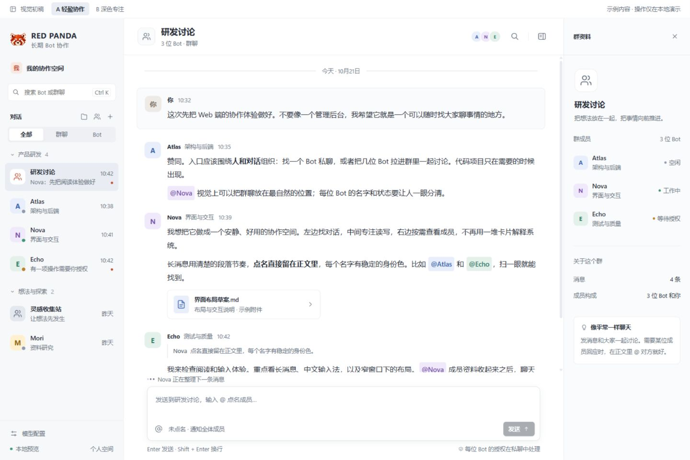
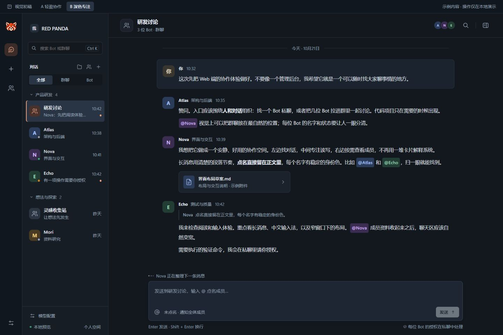

# RED PANDA 本地前端设计初稿

两版可点击视觉提案，使用真实项目品牌与已实现的产品边界；对话、成员和命令均为明确标注的示例数据。没有模型调用、后台操作、上传或外部网络请求。

从仓库根目录启动任意静态服务器，在浏览器打开 `/designs/web-redesign/`。`index.html` 为「轻盈协作」，`focus.html` 为「深色专注」。两版共享场景、交互与身份颜色，区别在布局、密度、导航和资料面板的呈现方式。

可体验：切换群聊与 Bot 私聊、搜索与类型过滤、折叠导航分组、新建 Bot / 群聊 / 分组、移动对话到分组、发送示例消息、点名候选与键盘选择、回复引用、复制消息、成员资料开合、Bot 的授权示例、模型设置示意、窄屏导航。预览状态仅保存在当前页面内；切换方向或刷新会恢复初始示例。

推荐先评审「轻盈协作」：它把消息阅读放在首位，群聊和 Bot 放进同一套可分组名册；「深色专注」提供更紧凑的另一种组织方式。

当前没有修改生产前端。按所选 Superdesign skill 的设计先行流程，用户选定方向后才把视觉整合到 `web/src`，沿用现有 API、状态与组件契约。

浏览器已检查 1440×960 桌面与 390×844 手机布局，验证点名选择、换行与发送、回复引用、消息搜索、分组创建和移动、群成员数量校验、草稿保留以及授权示例。未连接真实后端与模型；系统中文输入法和移动设备虚拟键盘未实机验证。

手机初稿见 [mobile.jpg](previews/mobile.jpg)。
