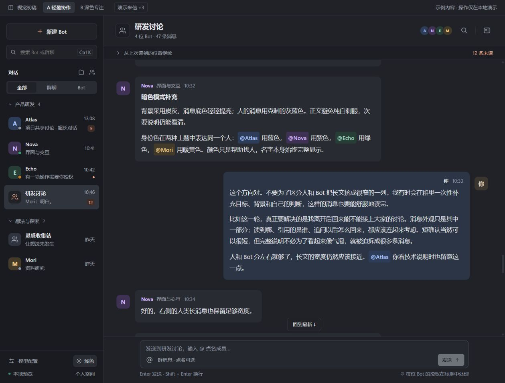
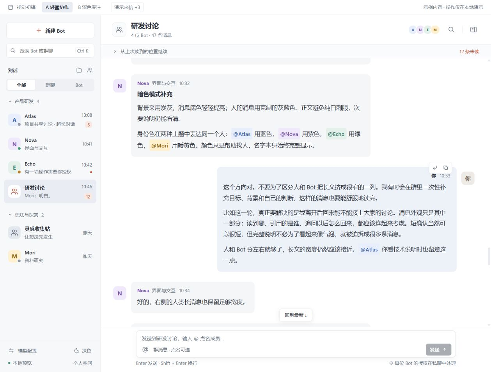
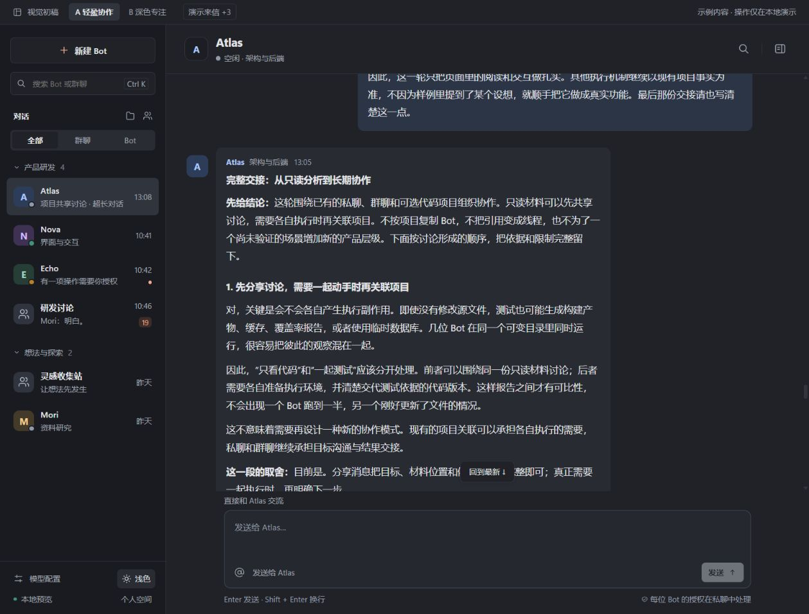

# RED PANDA 本地前端设计预览

当前采用 A「轻盈协作」，提供同布局的浅色与炭灰暗色模式。B「深色专注」保留为早期布局对照。所有对话都是明确标注的本地示例，没有模型调用、后台操作、命令执行、上传或外部请求。

从仓库根目录启动静态服务器，打开 `/designs/web-redesign/index.html`；暗色可直接打开 `index.html?theme=dark`。左下角切换明暗时保留当前对话与草稿。默认进入 Atlas 超长私聊的补读起点；这段对话有 69 条消息，约 1.16 万字符，围绕同一背景连续追问，包含人的长说明、Bot 完整长报告、短确认、列表、代码、diff 和跨历史引用。最长一条约 3200 字，在当前桌面窗口约占 7 屏。Nova 保留 18 条私聊示例；「研发讨论」包含四位 Bot 的 47 条长短混合消息。

## 本轮阅读与交互

私聊优先持续交流，输入区较充分。群聊优先阅读，成员资料默认关闭，输入区默认紧凑，长文、换行或引用时展开。人的整块气泡靠右、头像在右侧，Bot 气泡靠左；两侧正文都左对齐。浅底色跟随内容，所有长文气泡最多容纳 72ch 正文和内边距；短消息继续收缩。不因消息后段含代码或 diff 而加宽整条底色，也不在较宽底色内单独限制段落。代码和 diff 使用气泡内的可用宽度，长行局部横向滚动。引用和复制按钮跟随气泡边缘。

进入研发讨论会定位到未读分界。停在历史时点击顶部「演示来信 +3」，只显示新增数量，当前段落保持原位。主动回到最新或自然读到底部后恢复跟随。切换对话保留各自的阅读锚点、草稿和待发引用。

引用整条消息，展示原作者与简短预览，点击跳到原文后可以返回引用前的位置。引用不会自动插入 @，也不会创建新线程。从群里点作者或彩色 @名字进入私聊，顶部可以返回来源群聊并接续阅读。

名册搜索、类型过滤、折叠分组、创建 Bot / 群聊 / 分组、移动对话、消息搜索、发送、点名候选、引用、复制、成员资料和授权示例继续可用。Enter 发送，Shift+Enter 换行。

## 验证边界

本轮用真实浏览器检查桌面窗口与 390×844 窄屏：历史追加三条消息前后阅读位置一致；群聊／私聊往返保留阅读锚点、独立草稿与引用；引用跳转能返回；主动回到底部后继续跟随；普通消息无需点名发送。人的长消息和 Bot 长消息保持相同的宽度上限，代码在气泡内滚动；窄屏页面无横向溢出，输入区留在视窗内。

超长私聊复测：单条完整交接在桌面高约 4128px，窄屏高约 5509px，无折叠或内部纵向滚动。停在该条中段收到三条消息后，滚动位置保持 15516.8px；切到群聊再返回、切换明暗后仍为同一位置，草稿保留。第 68 条引用第 2 条长报告，回看后返回位置一致。390px 窄屏下页面宽度仍为 390px，代码区独立横向滚动，输入区在视窗内。

气泡宽度修正后，复查用户指出的相邻 Bot／人消息：1259px 窗口下长文气泡均约 614px，内部正文约 582px，人的气泡比 Bot 向右错开约 221px；短确认约 317px。进一步检查 Atlas 第 66 条含代码的超长交接，气泡约 614px、段落约 582px，差值只有左右各 16px 内边距，无额外空白列。代码消息不再享有整条加宽的例外。浅色与暗色布局一致。

可重复体验：在 Atlas 的「完整交接」中段停下，写一段草稿，点「演示来信 +3」；切到研发讨论，再回 Atlas；点击末尾的引用回看开头，再点「返回引用前的位置」。预期每次都能接着阅读与输入。最后点「回到最新」恢复跟随。样例中的项目协作讨论仅为检验长文阅读，不代表后台执行结果。

预览状态只保存在当前页面，刷新或切换 A/B 会恢复初始示例。未连接真实消息流、后端或模型，未验证系统中文输入法、手机虚拟键盘和阅读进度的持久同步。

## 与实际前端的关系

A 是本次 `web/src` 视觉与阅读交互的设计基准，模板与实际前端一起保存。模板中的示例消息、演示来信和模拟状态仅供设计检验，不会进入正式应用。正式前端使用真实名册与消息，保留附件、模型选择、授权、执行和文件审阅等已有能力；群聊与私聊共用输入框视觉，群聊默认紧凑，私聊保留较充分的输入空间。

模板的消息搜索、最近消息摘要、侧栏时间与未读数不代表本次实际前端已经接入这些能力。实际前端的验证结论与未验证范围见对应 PR；本机完整记录保留在 `.tools/`，不随模板发布。

