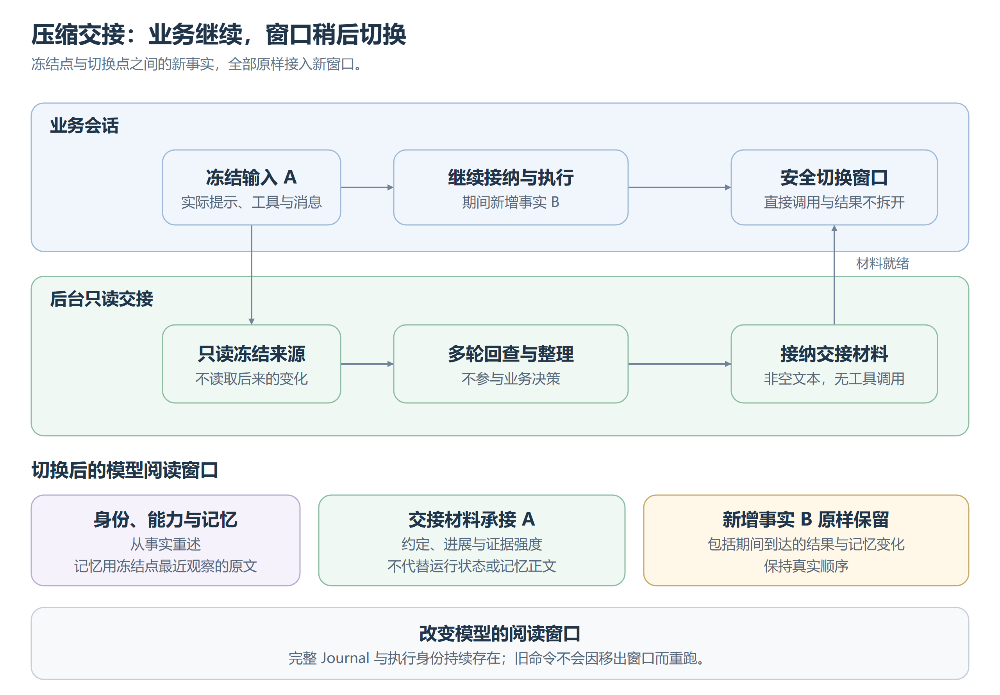

# 上下文压缩

Compact 切换同一 Session 的模型阅读窗口。完整 Journal、执行身份、工具激活与委派关系持续存在，旧内容移出视图不会让命令重跑。

## 执行模型

[可编辑图源](images/压缩窗口交接.svg)。冻结的是实际输入的系统提示、工具定义与消息，不按后来的目录变化重组。

后台可多轮回查冻结来源，只执行只读能力，不能修改文件、委派、发消息或控制业务；看见工具定义不等于有权执行。后台阅读记录不注入业务上下文。只有无工具调用的非空文本可接纳为交接材料，接纳后不可重新生成覆盖。

## 窗口和来源

冻结与切换都须等直接调用及结果收口，不拆开调用批次；普通子协作可以继续。期间新增事实全部保留，不按本地 token 估算裁剪，也不另拼旧历史尾部。

新窗口在摘要前重述当前能力目录、Bot 名字、群成员与例行任务。[记忆](记忆.md)重述冻结点最近观察的原文，期间更新按原顺序接入。摘要只承接往来、职责、约定和工作，不拥有身份、运行状态或记忆正文。

交接保留证据强度：计划、执行声明、验证与未知不能互换。未结束的往来按对象和工作保留，不强行归成一个当前任务；用户指定环境与已验证执行方式分开，不把一次子 Shell 激活当成持续状态。运行状态从事实恢复，有疑点再回查，缺少结果不构成重试副作用的依据。

## 历史回查

业务模型可回查授权范围内的完整逻辑历史；后台限于冻结来源，不能任意选其他会话。检索按明确时区的时间、事件范围与关键词字面匹配，返回有界原文线索、记录时间和固定引用，保持历史顺序。取得线索不等于读过全文，事件位置也不是 Step 编号；工具结果随原助手回合回查。

查询固定历史截止位置，续页沿用同一切面；新结果、查询自身记录与窗口切换不改变旧页。多次压缩后仍能从原消息定位追溯实际冻结材料。

## 触发与恢复

触发看当前窗口最近一次已提交响应的实际输入用量，包含缓存命中，不估算。阈值为业务继续增长留余量，不能保证不超 Provider 容量；超限在调用边界暴露。切换后等待新窗口实际用量，后台沿用启动时的模型与调用偏好。

失败保留诊断，业务继续使用旧窗口，不自动重试或发布半成品。已接纳材料的发布中断后接续原发布，过期来源不能覆盖较新窗口。停止业务不取消交接；子协作结束或执行失败后，未发布交接作废，已发布窗口保留为历史。

## 为什么不设调用上限

交接不以调用次数或总时长强制收尾，由 [LoopGuard](LoopGuard.md)提醒进展，模型决定继续、调整或报告阻塞。系统仍保证读取权限、接纳条件与具体操作的资源限制，未知异常不能变成交接成功。

压缩不能解决工具定义本身独占容量，也不保证摘要质量或服务端缓存命中；这些需要真实模型评测。
