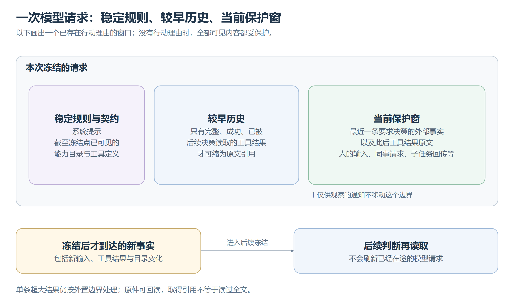

# 上下文投影

上下文回答“这次模型实际看到什么”，不拥有执行状态。窗口切换见[上下文压缩](上下文压缩.md)，图片与普通文件见[多模态附件](多模态附件.md)。

## 冻结一次判断

[可编辑图源](images/上下文保护窗.svg)。静态规则在异步读取前固定，动态内容只取冻结位置以内的事实。

能力已加载但成功结果尚未提交，仍不可见；产品登记变化也须先成为本会话的更新事实。消息旁标明接纳时间与来源，不能冒充发送时间。实际请求、响应与用量可回查，但请求记录不反写决策或产品配置。

## 保护窗与结果缩减

保护窗从最近一条要求决策的外部事实开始，包括人的输入、同事请求、定时唤醒、子任务回传和控制终局；群抄送、目录变化、入群通知与进展提醒不移动边界。没有行动理由时，全部可见内容受保护。

较早结果须调用批次完整、成功且被后续决策实际读取，才可缩为引用。失败、未消费和不完整的普通大小结果保留原文；结果排在旧调用旁不证明已被读到，插话也不消费后来结果。外部唤醒推动边界后，接受必要的前缀缓存失效，不按语义有用程度保留旧结果。

## 原文与回读

单条超大结果独立受外置边界限制，完整原文存入 Session 隔离的原件，呈现来源、预览、原工具提示和回读入口。以后缩减复用同一原件，不层层外置回读结果。

历史检索找固定引用，内容回读取范围或关键词原文；关键词只作字面匹配。片段与续读用同一坐标，不能把引用或片段当全文；图片整件回读，不套文本分页。

结果须区分未执行、等待、确定结果与结果未知，保留中断原因和部分证据。报错或确认丢失不证明没有副作用。控制、工作区绑定与压缩恢复的内部信息不进入模型消息，历史回查同样遵守可见性边界。

## 前缀稳定性

系统提示只放稳定规则和会话内不变的环境事实。日期、名册、委派与能力变化按来源追加，目录不每轮回填开头，未变化不重复。工具说明只写用途、参数和限制，定义按名称排序，不因加载顺序或最近失败改变。

保持渐进加载，真实变化造成的缓存失效可以接受，不为缓存提前暴露全部能力。Skill 目录、正文与资源按需供给，文字不等于已注册执行能力。[记忆](记忆.md)与[工作计划](工作计划.md)各守自己的事实源，不为稳定前缀复制当前值。

## 用量与压缩

用量取当前窗口最近一次已提交响应的实际输入，包含缓存命中，不累计或估算。切换窗口后等待新数据；投影器不因 token 用量拒绝请求。

Runtime 不做上下文缩减；投影不临时刷新 Journal 尾部，不把缓存当事实，也不为未知事实类型加序列化兜底。
