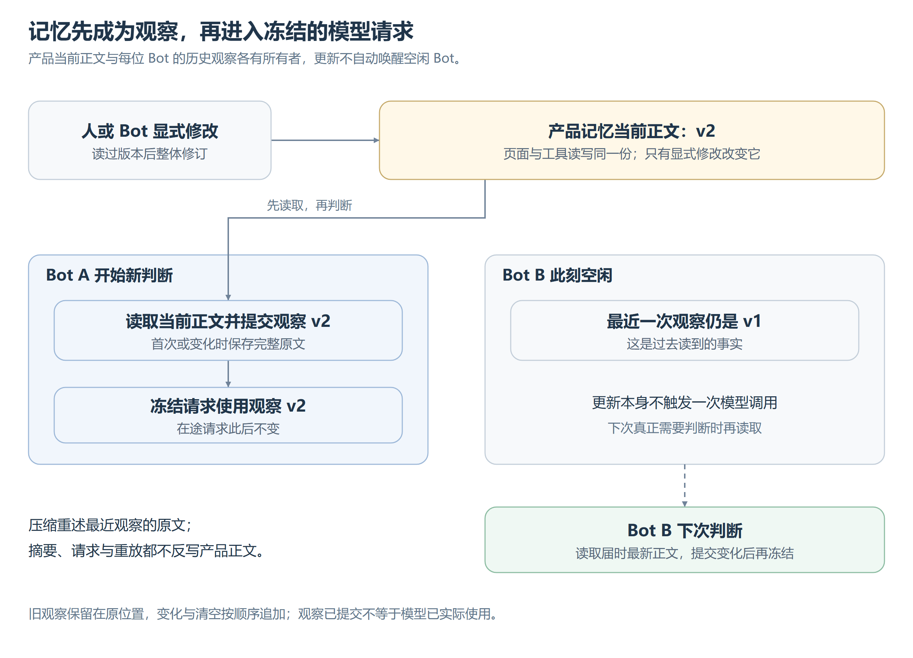

# 记忆

记忆承载短、常用、常改、场景无关的工作约束。当前任务用[工作计划](工作计划.md)，经历查[历史](上下文压缩.md#历史回查)，稳定知识和方法归档后按需读取。

## 适用范围与维护

共同记忆面向团队，个人记忆跟随 Bot 长期身份，不随项目、改名或压缩改变。个人约束只补充共同约束，例外须有用户依据。人可编辑两者；Bot 可维护共同正文和自己的个人正文，沿用工具授权。当前用户要求优先，记忆不扩大权限，也不替代身份和历史。

正文可为空，在较小硬上限内整体修订，超限拒绝而不截断。容量用于取舍，无须填满；过时删除、重复合并、明确纠正替换旧要求，临时要求不持久化。是否值得记住由维护者判断，系统不自动提炼或后台整理。

## 共同编辑与来源

修改基于已读版本；版本冲突返回最新正文，核对后再改，不能覆盖未读内容。Web 保留当前页面内未保存草稿并展示新版本，关闭或切换设置不丢草稿，切换 Bot 不串用个人草稿。

正文与修订来源一起保存，同一操作重试不重复修改。Bot 修改可回查执行记录，人的直接修改标明用户来源。

## 当前记忆、观察事实与上下文呈现

[可编辑图源](images/记忆观察与生效.svg)。产品存储拥有当前正文，Journal 拥有“当时观察到什么”；摘要与请求快照不恢复产品正文。

每次判断前读当前记忆，首次或变化后先提交完整原文，未变化不重复。工具写入成功也不替代这次读取。上下文只用已提交观察，变化与清空按序追加；旧版留在原处，失去当前效力，不回填历史开头。是否实际用于判断以冻结请求为准。

## 压缩与恢复

新窗口原文重述冻结点最近观察，期间更新按原顺序保留；摘要不复制或概括记忆正文，新判断仍读取尚未观察的变化。重述和重放不反写当前记忆。同窗只追加变化，切窗建立新前缀，不承诺跨窗口缓存命中。
