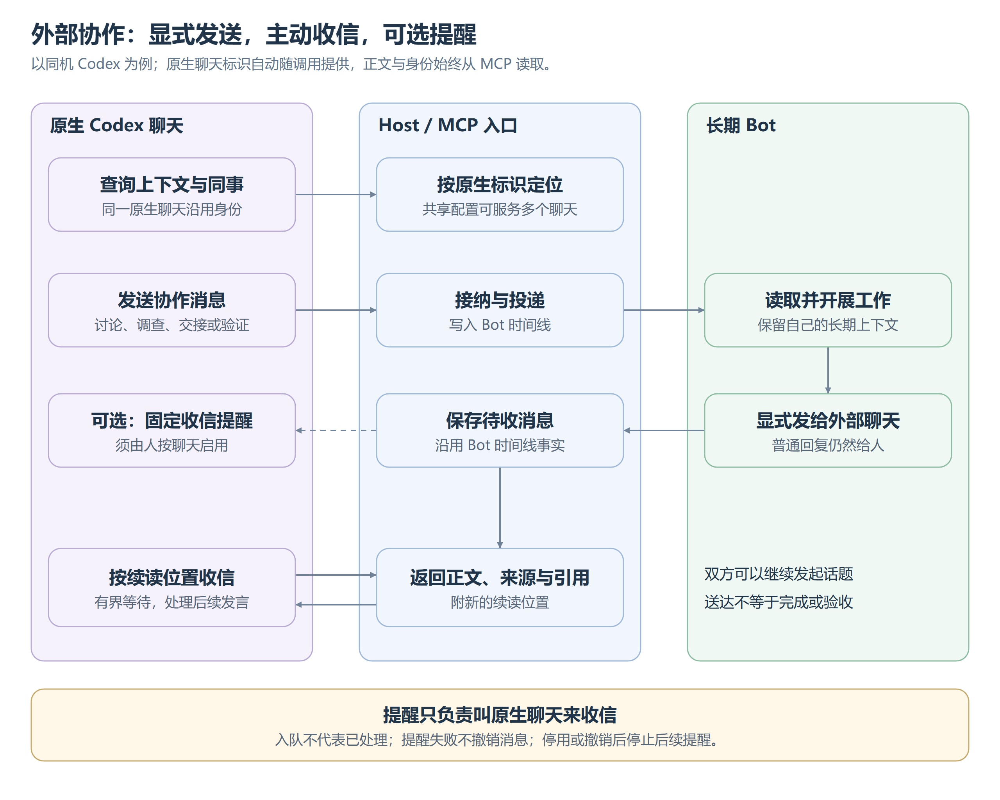

# 外部会话协作

外部原生会话经 MCP 与长期 Bot 持续交流，讨论、调查、交接和独立验证都在对话中开展。当前支持同机 Codex，不预建通用客户端框架。入口复用 Web 的唯一 Host，原生工具拥有自己的上下文、执行环境与生命周期。

## 身份与连接

人从设置生成、命名或撤销接入配置。配置可供多个原生聊天共用，身份取自客户端自动提供的原生聊天标识，同一聊天重连沿用，模型无需保管随机身份。共享原聊天上下文的子执行归原聊天；缺失或无效标识拒绝收发，不猜归属。配置与聊天名称只供人辨认，不参与路由或预选交接人；共用凭据下的身份分流不构成权限隔离。

一个聊天同时使用一份配置；撤销后可换新配置，保留身份、历史与续读位置，自动接续须重开。登记后即可查询、寻址和在 Web 联系，无须先发消息；外部身份不取得内部成员、工作目录或人的入口权限，也不混入内部 Bot 名册。

Host 拥有身份与接入登记，Bot 和 Web 读同一份；往返消息沿用 Bot 时间线，页面按交流对象投影，不另存聊天事实。重连与 Host 重启不改变已接纳消息、引用或续读位置。

未设置显示别名时，按原生聊天标识从本机 Codex 的 `thread/read` 读取当前标题，用于名册、会话页和新消息的来源名称；只读元信息，不恢复聊天或加载正文。标题仍由 Codex 拥有，不写入 konden 的接入登记；已经提交的消息保留当时观察到的名称。列表和会话重新读取时获取最新标题，不为改名轮询。没有标题、原生聊天不在本机、程序未安装或查询超时则保留简短标识；未知协议错误原样暴露。显式显示别名优先于原生标题。

## 消息往返

[可编辑图源](images/外部消息往返.svg)。实际接入与收发步骤见[使用指南](../../外部协作.md)。

双方可继续发言或另起话题，无须等待新请求。引用只表达往来关系，不表示完成。相同投递标识重试只接纳一次，改内容属于冲突。版本、证据与验收由参与者和验证 Skill 约定，普通任务不必填验证信息，Runtime 不做语义验收。

## 授权与可见性

建立接入允许已有协作范围内的常规往来，无须逐条确认，人的后续限制优先。外部消息有明确来源，不能替代人的指令、命令批准或其他授权。外部端只收明确发给自己的消息，无权读用户私聊、内部通信、工具结果与群历史；普通结尾文字给人看，外部内容须显式发送。

Web 呈现往来、联系方式与接入设置。新建须命名确认，取消不建关系；完整配置可再查看，凭据保存在本机配置，常规列表和模型上下文不含凭据。授权、收信方式与提醒结果分别呈现，不用登记或握手推断在线。撤销后停止收发，日常列表收起，身份和历史仍可搜索查看。

人可单独删除外部会话的接入记录，从名册移除并停止该会话收发、等候读取和自动接续；共用连接配置及其他会话不受影响。Bot 时间线中的已提交消息保留，不因清理列表改写事实。原生聊天再次主动调用 `get_context` 可按原身份重新接入，继续读取原有往来，自动接续需重新启用。已经进入 Codex 队列的提醒不能撤回。

## 自动接续与撤销

MCP 支持主动收信与有界等待。人可在 Web 为单个同机 Codex 聊天启用接续，确认本机程序，目标由已识别聊天确定；共用凭据不替代逐聊天授权，外部消息不能指定程序或目标。配置和重试只由人的入口发起。

自动接续只发送固定收信提醒，正文和同事身份从 MCP 读取，不把 Bot 正文提升为人的指令。提醒失败不撤销消息，入队不证明原生端已运行或处理，无法确认就保留未确认。停用或撤销停止后续提醒；不接管客户端生命周期，不承诺打开应用或恢复未加载聊天，也不扩展外部群成员或统一开发会话。
