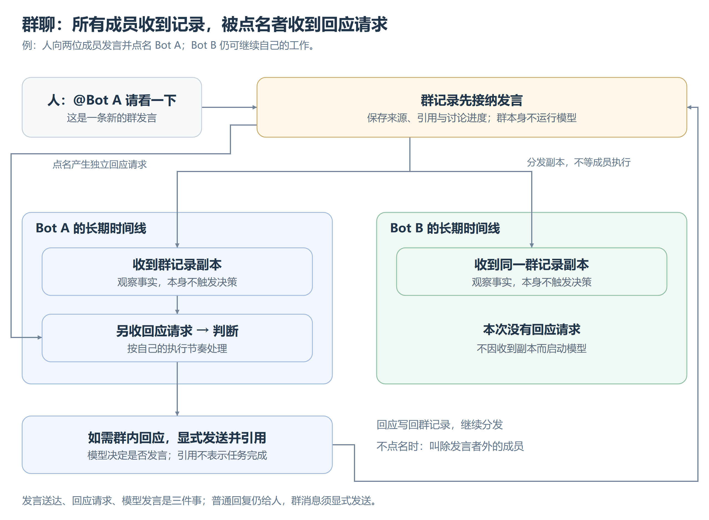
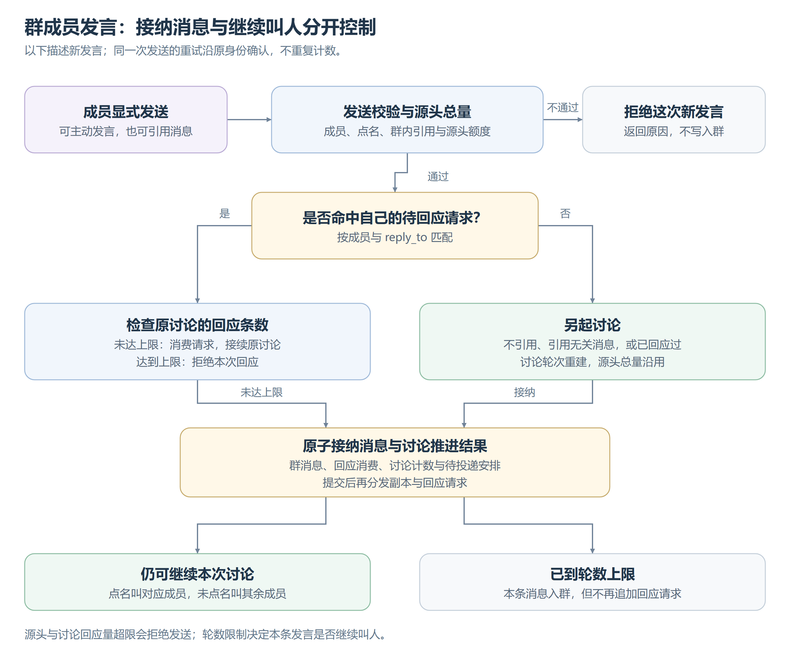

# 群聊

## 分发与回应请求

[可编辑图源](images/群聊分发与回应.svg)。成员仍在各自长期时间线工作，群按名字寻址，成员关系不依附项目。群记录不运行模型，Host 只安排回应请求；投递不等待任何成员工作结束。

成员可以主动发言，无须先被点名；收到回应请求也不强制发群消息，没有新内容可不发。普通回复仍给人，入群内容由模型显式发送，取舍见[交互与响应](交互与响应.md#普通回复给人协作消息显式发送)。

## 成员发言如何接纳

[可编辑图源](images/群成员发送控制.svg)。Host 校验发言者属于仍有效的群，点名只能指向其他当前成员，引用必须来自本群；这些规则与发送额度由系统保证，是否值得说、说什么由模型判断。

只有 `reply_to` 命中“这个成员尚未回应的请求”，才算接续原讨论，并消费这一次回应关系。没有引用、引用别的群内消息，或再次引用已经回应过的消息，都作为新讨论入队。**一次回应关系只消费一次，不等于一个成员只能发一条消息。** 例如先引用原请求报告阶段结果，稍后补充最终结论，后一次仍可发言，但按新讨论处理；省略引用不会刷新源头总量。

新讨论不替换其他待叫成员。同一待投递批次按成员合并并保留先到的请求，其余群消息仍可见；已经发出的请求按成员与原消息分别保留。成员判断时读取当时已到达的记录，不保证每条群发言都单独触发一次模型调用。队列排空后群调度静止，成员仍可继续工作，晚到发言可再追加请求，无须等全员回答后才推进。

## 讨论怎样收束

Host 同时执行三项机械限制，不设主持模型，也不读正文判定闲聊。当前默认值如下；轮数从讨论的首批回应请求计起，回应条数由参与该讨论的全体成员共用。

| 限制 | 计数范围 | 达到上限后 |
|---|---|---|
| 讨论轮数：3 轮 | 同一开场消息沿有效回应关系派生的轮次 | 第 3 轮的回应仍可入群，本条不再追加下一轮请求 |
| 讨论回应量：10 条 | 同一开场消息派生的有效回应总数 | 拒绝这次讨论的后续回应，不写入群 |
| 源头消息量：20 条 | 同一非 Agent 输入驱动的所有成员私信与群发言，跨群累计 | 拒绝新发送；另起讨论或转私信都不清零 |

源头沿已提交决策与工具结果回溯，批次以首条输入归因；它是通信计数依据，不是任务的语义归属。另起讨论可重建轮数与回应额度，但不改变本次发送的因果源头，也不重置这份源头额度。轮数用完只停止本条发言继续叫人，不撤销已投递请求或成员执行；所有限制同时生效。

## 提交、恢复与人介入

群发言、回应消费、讨论计数与待投递安排在同一次群事实中提交，之后才分发副本与回应请求。重试沿原发送身份补齐，不重复发言或扣额度；同一身份改正文属于冲突。重启从群记录恢复推进和源头用量，不靠成员正文重建派单，也不把进程内计数当唯一依据。

人的新发言替换当前待推进的讨论安排与旧回应关系，但不撤回已投递请求或打断成员工作；之后引用旧请求也不能恢复旧讨论。群不提供强制停止，停止和授权分别在对应 Bot 的控制与私聊中处理。解散后停止新发言与回应，不恢复旧讨论；历史只读保留，成员其他工作继续，群名不重用。
