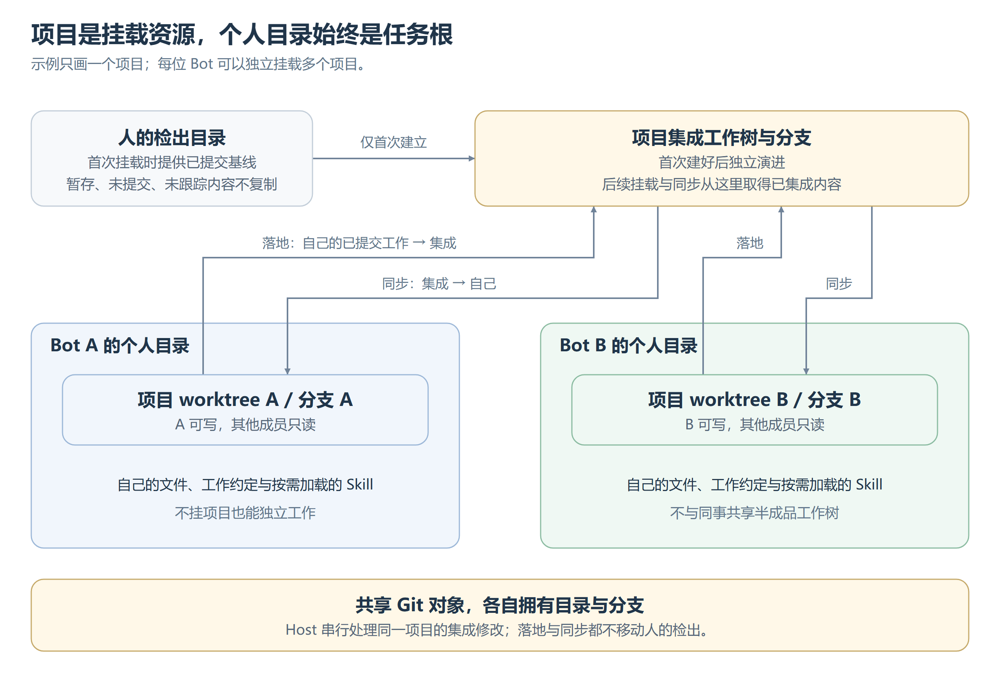

# 项目与工作树

## 项目归属与执行目录

[可编辑图源](images/项目与工作树.svg)。挂载不切换任务根，模型按真实路径操作项目，实测见[项目挂载](../../历史/执行环境实测.md#任务根与项目挂载)。

个人目录持久存在，重启和压缩不改变；没有项目也能交流、处理文件和执行授权命令，普通目录不自动建 Git。项目按本地仓库登记，不重复登记每棵工作树；须已有首个提交，不接受无效根或裸仓库。人的目录选择确认后生效，模型指定新路径须人批准，引用已登记项目无需重复批准。Host 准备工作树与分支，调用方不指定内部目录。

首次集成基线来自人的已提交检出，后续不随人移动；不同数据根不争用集成分支。同事目录只读，放开其他宿主路径也不解除该边界，授权与隔离见[执行环境](../能力/执行环境.md)。

解除只删除自己的工作树与分支。未提交、未落地、合并未完或子协作未结束时拒绝解除；重挂从当前集成分支开始。准备与解除沿原操作收口，确认丢失先核对，恢复后再使用；结果不明不删除，清理不遮蔽原错误，外部 Git 环境与钩子不得改变项目归属。

## 编码方法与工作流

编码方法与 Git 协作分别作为 Skill 按需加载，用户流程与项目约定优先；个人目录也支持工作约定和自定义 Skill。Skill 提供方法，不授予能力、权限或固定流水线；项目工具负责工作树隔离，父子共享文件由父安排。

## Git 历史、落地与同步

Agent 决定提交范围、时机与验证，系统不在回合、压缩或重启时自动提交。提交使用 Bot 身份，不改用户配置；负责提交不等于获准推远端、改他人分支或重写历史。成果以实际提交为准，差异为空不证明从未修改。

图中的落地与同步由模型选择，Host 执行，同一项目集成修改串行；两者均单独调用，不与同一步其他工具并行。落地不逐次审批，不压缩提交，不触碰人的检出。

落地冲突放弃该次合并，集成不变；同步冲突留在自己的工作树，由 Agent 解决提交或放弃。覆盖风险阻止操作，不自动清理；其他 Git 错误不能统称冲突，也不保证失败现场未变。取消等操作收口，恢复只在能证明现场仍对应原合并时接续，不猜测外部修改。结果留在原调用事实，内部集成坐标不成为模型的操作负担。

当前无文件回退或对话分叉；Git 不覆盖忽略文件等全部副作用，见[AgentFS 的取舍](../../历史/AgentFS取舍.md)。

## 委派

[SubAgent](../运行/SubAgent.md)共享父的个人目录与项目文件，能看未提交内容，系统不另建工作树或自动提交集成。父安排范围、顺序与 Git 用法；子普通回复给父，过程不自动灌入父上下文。父验收文件和证据后显式回收，保留成果与历史，解除项目前须结束相关子协作。
