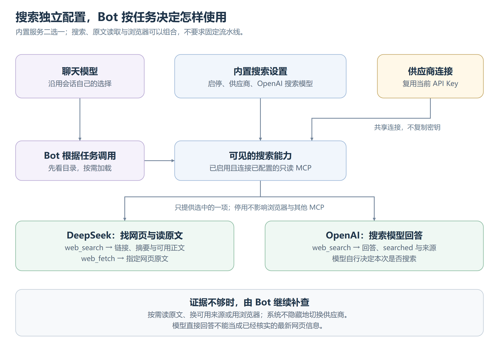

# 网络搜索

网络搜索让长期 Bot 取得公开网页资料，与聊天模型独立选择。操作见[网络搜索配置](../../模型配置.md#网络搜索)，本文解释能力怎样接入、结果意味着什么。

## 配置与调用

[可编辑图源](images/网络搜索流程.svg)。内置搜索一次选择一个供应商；另外安装的搜索 MCP 与浏览器仍可独立使用。

搜索设置按数据根共享，保存在当前连接文件旁的 `search.json`，只记录启停、供应商和 OpenAI 搜索模型；凭据仍由 `connections.json` 拥有。更换聊天模型不切换搜索服务，保存搜索也不改聊天候选、默认值或会话选择。没有搜索文件时默认启用 DeepSeek，仍须配好对应连接。

Bot 的搜索能力沿用 MCP 加载与调用边界，不增加 Runtime 分支。模型下一次判断得知目录变化，再按需加载；在途请求不改写，旧契约变化后须重新加载，不静默替换。停用只移除内置搜索能力，已加载工具也不能继续绕过停用状态。

## 两种服务的结果

| 服务 | 提供什么 | 结果怎样理解 |
|---|---|---|
| DeepSeek | `web_search` 找来源，`web_fetch` 取原文 | 搜索默认返回摘要，可请求附正文，但正文可能缺失；已取得足够正文时无须重复抓取 |
| OpenAI | `web_search` 把问题交给独立选择的搜索模型 | 返回模型回答、`searched` 与来源；`searched=false` 表示直接回答，本次未检索，不能作为已核实的最新信息 |

OpenAI 使用 Responses 的自动工具选择，由搜索模型决定是否联网；应用不另设“强制搜索”等模式。模型回答、检索摘要和网页原文各有证据含义，即便 `searched=true`，也不能把回答当作完整原文。自动选择与来源机制见 [OpenAI 官方说明](https://developers.openai.com/api/docs/guides/tools-web-search)。

## 测试、补查与失败

Web 测试使用当前草稿，展示是否检索、回答或来源及耗时，不保存草稿、不改会话。DeepSeek 测试只展示实际来源，不额外生成回答。连接已配置只说明设置齐全，真实权限、联网能力与目标网页是否可读要看调用结果。

Bot 按[检索方法](../../../konden/skills/bundled/web-research/SKILL.md)组合来源、正文与浏览器：已知 URL 可直接读取或打开，需要动态内容、图表或交互时继续用浏览器，搜索成功也可以补查。保留来源、日期与适用范围，区分原文事实和推断；网页内容不产生人的授权。

认证、余额、限流、网络或网页访问失败明确返回，Runtime 不改查询、不隐藏地换供应商，也不把失败变成空结果。模型决定重试、换已启用服务或报告缺口；未知异常与损坏配置原样暴露。密钥在调用边界读取，更新无需重启，也不复制到能力目录或会话事实。
