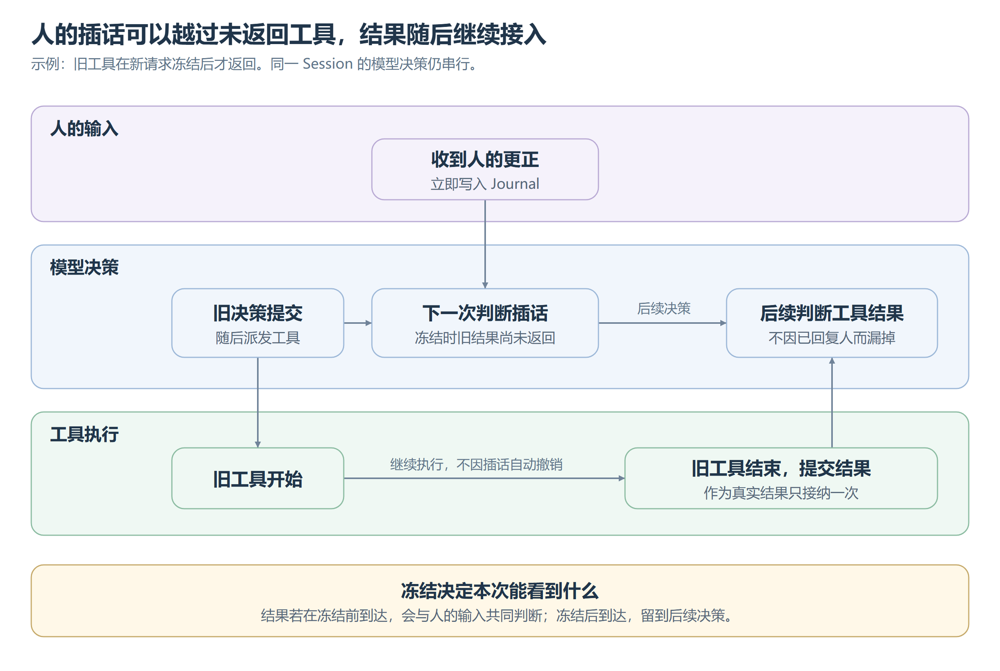

# Runtime

Runtime 只负责持久事实、状态归约、原子决策和命令派发约束，不理解目标、对话、工具领域含义或任务完成。状态所有权见[运行语义规约](../运行语义规约.md)，进程边界见[会话进程与恢复](多活跃会话.md)。

## 核心模型

Session 是持续的执行生命线，不等于一次问答、函数调用或进程。入口与委派方选择身份，创建只建立生命线，不凭空产生输入或决策。

Event 是已经发生并被接纳的事实，提交后不可原地修改。State 只由有序事实确定性归约，丢失缓存后仍可重建。Journal 能重放历史切面，说明决策当时依据什么、又产生了哪些操作。

Step 是一次原子的模型决策：冻结输入，调用模型，然后把决策、输入消费和零到多个 Command 一起提交。工具执行在 Step 之外；一次交互可以跨多个 Step，每次推进最多提交一个决策。

```text
Event → State → Step → Command → Outcome → Event
```

输入接纳不等待整轮工作结束。执行器只派发已提交且获准的命令，结果必须先提交为事实才影响后续决策；同一 Session 的推进保持串行，不因重复唤醒而并发决策。

## 决策一致性

人的输入、要求决策的外部事实、授权拒绝和收齐的工具结果都可能成为决策依据。人的待处理输入优先成批进入；没有人的输入时，其他来源按接纳顺序逐条处理。逐条判断保留了根据中间执行结果调整后续行动的机会，不把人的输入成批政策推广为一次处理全部外部事实。

模型调用前冻结本次所见事实，后来到达的内容只影响后续 Step。提交时确认整批输入尚未消费、冻结依据仍有效且会话可推进，条件不成立就不提交旧决策。目录更新、压缩检查和窗口切换必须与这次冻结依据一致，不能让旧检查用于包含新事实的决策。

### 取消当前自动决策链

取消只作用于当前决策批次，不终止 Session，也不代表系统理解并取消了整项任务。决策尚未提交时，取消与提交竞争同一批输入：取消先发生则旧决策不能提交；提交先发生则只关闭该 Step 的自动续步，不吞掉下一批输入。当前尚未开始决策时，取消覆盖此刻选出的待处理批次。

取消事实保留自己的覆盖范围，不冒充模型已经处理。冻结后才到达的新输入仍可触发后续决策；普通新消息也不隐式取消当前执行。前台命令的终止见[打断](#打断)。

## 用户输入与后到消息



[可编辑图源](images/插话与工具结果.svg)。输入立即写入 Journal，不抢占当前模型调用，也不撤销外部操作。产品动机和回复去向见[交互与响应](../多智能体/交互与响应.md)。

人的未消费输入按原身份、正文与顺序成批判断，不猜哪条是更正；可越过未返回工具，结果如实标明未明，模型决定是否等待或核对。其他决策来源仍等旧操作收口，不推广为并发工作流。冻结前到达的结果共同判断，后来结果独立续步，只接续一次。

被越过的未处理决策输入暂不展示，已处理历史与观察事实仍可见。这避免重复交付，不保证模型不重复行动。消费只表示整批被成功提交的决策处理，不表示逐条答复或任务完成；失败则整批不消费，可和新输入重新选取。重放保持原覆盖范围，不重跑现行政策；人持续输入可能使其他来源一直等待，这是接受的优先级代价。

## 副作用与恢复

Command 在 Step 提交时冻结，执行前先持久记录 Attempt，取得确定结果后再提交 Outcome。同一步可并行执行多个命令，结果按实际到达顺序记录；工具结果独自续步时等该组全部结束后只触发一次后续决策，不妨碍人的插话。不需继续判断的操作仍留结果，但不单独唤醒模型。

已知外部错误在对应边界转换为确定结果，未知异常原样暴露。已经开始却没提交结果的操作保持未知，不因恢复盲目重试；失败也不能证明没有外部副作用。异常聚合只有全部叶子都是已知外部错误才可转换，取消和未知异常不得降级，清理失败不能遮蔽原错误。

新 Worker 独占接管后，把旧执行者不会再带回结果这一事实留下。它不是成功或失败，原操作仍未知，但不再阻挡后到输入或让本该续步的一组命令永久等待。模型看到缺少结果后判断现场；能核对结果的领域使用自己的窄恢复协议，不建设通用补偿状态机。

恢复从 Journal 重建状态与可丢弃投影，只在重建状态允许时继续决策。历史 Attempt 不删除，已发生事实不改写；SubAgent 的中断回传见[SubAgent](SubAgent.md)。

## 打断

显式打断先关闭当前自动续步，再终止仍在前台等待的命令，最后记录“已中断、结果未知”。不能先记录成功终止再尝试杀进程，否则模型开始核对时现场仍可能变化。终止失败原样暴露；记录前进程退出则按原命令身份核对，不重跑。

打断覆盖该 Step 的全部前台命令，派发与终止必须收口，不能让排在后面的命令在打断后才开始。自然结束与终止按同一身份只接纳一次，先提交的终局有效。部分输出作为证据保留，不能冒充最终结果；中断仍要为调用生成配对结果，不能留下协议上悬空的调用。

打断不回退文件、不自动重试，也不终止 Session。已经转后台的命令用独立停止动作处理；不为所有文件工具和外部协议预建通用取消，不从用户正文猜测停止。具体进程回收边界见[执行环境](../能力/执行环境.md#命令生命周期与后台执行)。

## 状态与 Journal 保证

可运行表示存在尚未消费且当前可执行的决策事实；等待可能是等外部事实、授权或命令结果，不等于一定在等人。“正在跑”是瞬时执行活动，任务完成是语义判断，归档、删除与进程退出各属自己的生命周期。

Journal 保证 Session 内事实有序、按稳定投递身份幂等接纳、整批输入原子消费、Step 与执行尝试原子领取和提交。一个命令最多开始一次尝试，一次尝试最多产生一个终态结果，自动续步权最多关闭一次；这些保证不等于外部副作用恰好发生一次。

## 投影边界

上下文、执行过程、请求记录和 Checkpoint 都来自事实，不能反向成为运行状态。摘要是语义材料，不能兼任运行快照；需要随决策保存的应用元数据对 Runtime 保持不透明。

持久格式与缓存精确版本化，不读旧格式。只有测量证明重放是瓶颈后才优化，不能以削弱持久保证换取未经证实的性能收益。
