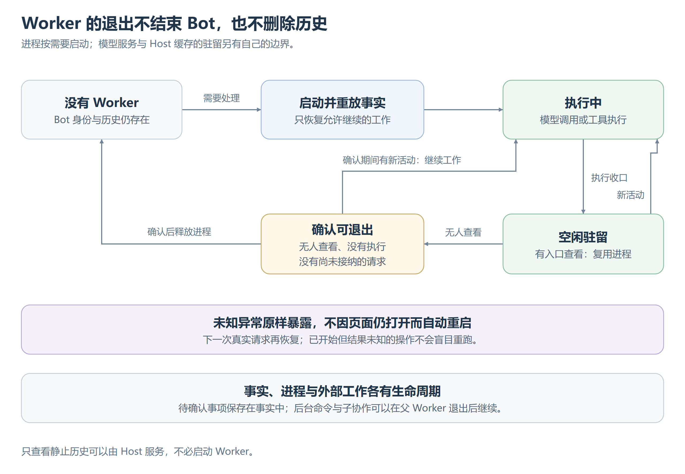

# 会话进程与恢复

每个活跃 Session 用独立 Worker 持有执行循环、Runtime、工具、MCP 客户端与 Journal，模型调用复用 Host 的 Provider 客户端。进程隔离执行故障域，不等于安全沙箱，也不把每个工具另开进程。内存、卸载与存取路径见[运行机制](运行机制.md)。

## Host 与 Worker

同一数据根只有一个 Host，先独占数据根、接管旧执行，再开放定时与外部入口；第二实例报错。占用随进程结束释放，Worker 不跨 Host 存活，恢复时可确认旧写入者已退出。

Host 定位会话、保证单 Worker、投递唤醒、路由父子回传并维护入口选择，不解释正文、归约 Runtime 或判断完成。各页面独立声明所看会话，影响空闲驻留与回复路由，不构成人的授权。

## 进程身份

进程沿用启动者的系统身份与权限。产品工具环境和项目命令环境分开准备，不覆盖项目环境；按明确环境找 Shell，不扫描项目猜解释器。Worker 不继承 Channel 协议管道，各入口与子协作、后台交接遵守同一启动约束，缺失环境如实报告。

Windows 补全本机用户会话环境并保留调用方已有设置；其他平台不预建未经实测的登录环境模拟。

## Worker 生命周期

[可编辑图源](images/Worker生命周期.svg)。启动与退出中到达的投递等待转换，写入目标 Journal 后才能确认送达，不能因退出丢请求。

未知异常退出还须清除旧进程的运行、预览与工具活动展示，但不补造工具终态。待确认事项可重放，结果未知的操作保留未知；有领域核对协议时按原操作恢复。

Host 重启自动接续原本可自行推进的顶层 Session；父若仍有子协作，也恢复原关系，子随父恢复。已批准未开始可继续，待批准仍等待，仅等外部输入不提前拉起。停止当前轮不形成持久暂停，后续消息和结果照常接纳；后台命令独立补报，见[执行环境](../能力/执行环境.md#命令生命周期与后台执行)。

## 事实与进程的边界

每 Session 一个 Journal，隔离写入与历史扫描。Host 查询缓存可丢弃，但后续须看见新事实，不能参与幂等或恢复判定。跨进程只传请求与生命周期信号，不复制 Runtime；送达以事实接纳为准，进程异常不能改成普通工具结果。

产品配置与扩展登记按数据根共享，文件范围由会话绑定。长期 Bot 以个人目录为任务根，项目挂载不改变它，见[多智能体](../多智能体/总览.md#项目归属与执行目录)。

## 父子 Session

父子用相同进程与 Journal 边界，关系由 Assistant 拥有。父先记录委派，按稳定身份建立子任务，再启动子 Worker；派出不等于完成。父不持有或等待子进程，可以先空闲退出。

子回复先存自身事实，再按原身份可靠投递，父只接纳一次。父从自己的未结束委派恢复关系，不扫描无关会话。子空闲不等于结束，父判断成果并显式回收。

## 租约与接管

租约到期只允许竞争接管，不证明执行者失败。接管与旧执行提交原子竞争，成功后才有新代次，最多一个有效写入者；无人接管，旧执行者恢复仍可提交。

时间本身不能制造结果未知。确认旧执行者已退出后，按 [Runtime](Runtime.md#副作用与恢复)保留原 Attempt 和证据，记录未完成执行。子已有回传只重投，不重调模型；没有回传则经原通道报告未知、未自动重试及相关操作。

未知异常退出前尽可能保存回传并暴露原错误；Host 先释放失败进程再投递，避免互等。子任务与 Journal 须在首次启动前原子建立，初始化失败也能找到父；损坏不能补成普通失败。当前只保证父获知中断，不建设子会话续跑或通用恢复协议。
