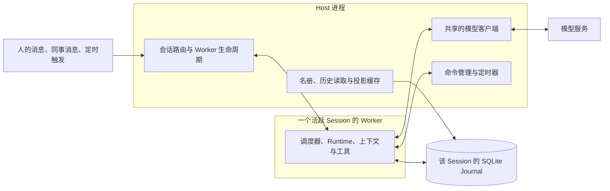

# 运行机制

本文说明当前代码如何把会话运行落实到进程、内存、调度与存储，以及这些选择的资源代价。共同不变量见[运行语义规约](../运行语义规约.md)，恢复与接管的完整契约见[会话进程与恢复](多活跃会话.md)。

## 一条消息的运行路径

假设一位 Bot 已空闲，Worker 也已退出。新的消息先到 Host，Host 按 Session 找到或启动 Worker，通过进程间管道转交请求。Worker 打开自己的 Journal、恢复执行状态并装配工具，将输入接纳为持久事实，再唤醒会话调度器。

Runtime 从已提交事实中选取本次输入并冻结判断依据。Worker 准备上下文，经 Host 中共享的模型客户端请求模型；返回后，将决策、输入消费与工具命令原子提交。获准的工具随后执行，结果再次写入 Journal，按运行规则继续判断或进入等待。

当调度链和在途工具都结束，Worker 向 Host 报告空闲。已有 Worker 仍被入口选中时继续驻留；无人选中且没有在途请求时，双方核对后退出。以后有新消息、定时触发或后台命令结果，再按需启动，身份与历史沿用原来的 Session。

图中按一个数据根展示运行关系；TUI 使用独立数据根与自己的 Host。命令管理和定时器可以在 Worker 退出后继续等待，再向原会话投递结果或触发。

## 内存驻留与卸载

Bot 是长期身份，Worker 是按需存在的进程。当前通过 `spawn` 启动独立 Python 进程，每个常驻 Worker 都有解释器、已加载模块和会话对象的开销；没有模型调用或工具调用，并不意味着这些内存已释放。

| 所在位置 | 主要资源 | 释放边界 |
|---|---|---|
| Host | 模型客户端、名册与协作索引、会话历史与投影缓存、在途请求 | Host 进程退出释放内存；部分资源有自己的替换与关闭流程 |
| Worker | Runtime、调度器、工具装配、MCP 客户端、事件快照与上下文准备数据 | 正常退出时关闭会话资源，并释放该进程内存 |
| 工具及命令的附加进程 | Shell、命令程序、已启动的 MCP stdio 服务等 | 由对应执行或连接所有者管理；后台命令不随 Worker 空闲退出 |

查看者影响的是已有 Worker 的驻留。仅打开一个没有待推进工作的会话，可以由 Host 读取历史并返回页面，不必启动 Worker。切换页面也不终止仍在运行的工作；等它真正空闲后，才判断是否退出。进程退出保留 Bot 身份、Journal、工作目录与成果，下一次启动从持久事实恢复。

**Worker 退出、Host 缓存释放和上下文压缩是三个不同动作。** 当前 Host 的会话读取器与投影缓存按需保留，没有随 Worker 退出清空，也没有统一容量淘汰；这部分内存会随已访问会话数和历史量增长。压缩改变提供给模型的窗口，不删除 Journal 历史，也不自动清掉这些完整事件快照。

模型客户端按 Provider 在 Host 内复用，但每个在途请求仍有自己的上下文和返回数据。Worker 不加载模型权重；如果用户另行运行本地模型服务，其内存属于该服务。子 Agent 与后台压缩也可能使用各自的 Worker，因此不能只按 Bot 数估算进程数和总内存。

驻留条件与退出握手可从 [Host 生命周期](../../../konden/assistant/host/supervisor.py)核对；进程故障、MCP 连接和命令后代的回收边界仍按各自契约处理。

## 执行调度

调度有两个层次：Host 路由请求并管理 Worker 是否存在；Worker 内的会话调度器根据事实推进 Runtime。同一 Session 同时只有一条决策推进链，重复唤醒会合并为后续推进请求，不为每条通知另建一个模型循环。不同 Session 在各自 Worker 中可并发工作，实际速度还受模型服务、磁盘和工具资源限制。

一次 Step 可以派发多个工具调用，以异步任务等待结果；工具自身的串行与独占约束继续生效。文件与普通工具在 Worker 的装配层执行；Shell 命令从启动起由 Host 的命令管理器持有，前台只表示当前调用还在等待。等待到点转后台后，Worker 可以继续决策或空闲退出，命令仍运行；Host 保存退出结果后，再向原 Session 投递完成事实。详见[命令生命周期](../能力/执行环境.md#命令生命周期与后台执行)。

工具等待与输入接纳分开。新消息可以先写入 Journal；人的后到输入何时进入下一次判断、旧结果如何接续，由 [Runtime](Runtime.md#用户输入与后到消息)的规则决定。等待授权的操作也保存在事实中，不需要靠一个持续运行的模型调用保住它。

定时器在 Host 中等待到期；群调度负责把回应请求送到成员，不等待成员完成长时间工作。这些触发进入原 Session 的同一条推进链，不为每次唤醒再创建长期 Bot。会话调度入口见 [SessionScheduler](../../../konden/assistant/runner.py)，共享模型连接的生命周期见[模型连接实现](../../../konden/llm/connections.py)。

## 数据库、读取与缓存

当前存储按事实与资源归属分开，不把所有 Bot 放进一份全局事件表。下表是主要分类，具体目录见[运行指南](../../运行指南.md)。

| 数据 | 当前存储方式 | 主要用途 |
|---|---|---|
| 单个 Session 的历史、运行索引与 Checkpoint | 每 Session 一个 SQLite Journal | 执行接纳、原子决策、查询与恢复 |
| 群成员关系、消息与协作进度 | 每群独立 Journal | Host 推进群协作，再向成员时间线投递 |
| 记忆、定时安排、压缩作业等产品状态 | 各领域自己的 SQLite 存储 | 保存当前值或领域执行记录，按契约向会话提供事实与观察 |
| 模型、连接、项目登记与外部接入关系等配置 | 对应 JSON 文档 | 经所属入口修改，以完整文档替换保存 |
| 长输出材料 | 按会话分块保存的 SQLite 内容库 | 按需读取正文，不把全部材料常驻在模型窗口 |
| 命令原始输出与退出证据 | 输出文件与退出记录 | 分段查看输出、核对结果和补报完成事实 |

### 事务与连接

Session Journal 使用 SQLite WAL。写入在 `BEGIN IMMEDIATE` 事务中完成，事件与消费、命令、执行尝试等索引一起提交或回滚。同一数据库的写事务仍然串行；分开 Journal 避免不同会话争用同一个会话数据库的写锁。

Journal 的常规异步读写交给线程执行，避免等待数据库时占住会话事件循环。连接按操作创建并在完成后关闭；Host 复用的是带内存快照的 Journal 读取对象，并不等于为每位 Bot 永久保留一个 SQLite 连接。SQLite 的锁等待、持久提交与数据解码仍有实际成本。

### 增量读取与状态投影

首次快照读取会加载该 Session 的事件；后续读取先查询最新序号，只补读新事件，再返回保留在内存中的完整事件序列。Host 与 Worker 的读取对象各有自己的快照缓存，可能同时持有同一段历史。**磁盘增量读取并不等于内存只保存增量。**

Host 查询同一份未变化的快照时，可以复用已经计算的运行状态；有新事件后，这条查询路径会重新投影完整快照。Runtime 的部分状态查询还会读取 Checkpoint，只有位置、事实指纹与版本都匹配才复用；实际决策推进仍从对应事实建立判断依据，不能把 Checkpoint 当作所有路径都已实现增量归约。

名册和消息源头计数等索引首次建立时可能扫描多条历史，之后在内存中随新事实更新。它们减少日常重复读取，代价是冷启动工作与 Host 驻留内存。上述会话缓存没有按内存压力自动淘汰的机制；观察长时间运行的占用，需要同时看 Host、Worker 和工具子进程。

读取与 Checkpoint 机制见 [Journal 实现](../../../konden/runtime/journal/sqlite.py)，Host 的查询复用见[会话存储与投影](../../../konden/assistant/host/session_store.py)。[历史性能记录](../../历史/长时间线性能.md)只代表当时实现与机器；本篇没有给出未经当前实测的每 Bot 内存、吞吐或延迟承诺。
